  

  

   

  
  
  

 

  

<h3 align="center"><code>// stack carregada</code></h3>

  &nbsp;
  &nbsp;
  &nbsp;
  &nbsp;
  &nbsp;
  &nbsp;
  &nbsp;
  &nbsp;
  &nbsp;
  &nbsp;
  &nbsp;
  

 

<h3 align="center"><code>// leitura do sistema</code></h3>

  
  
    
  

 

  

